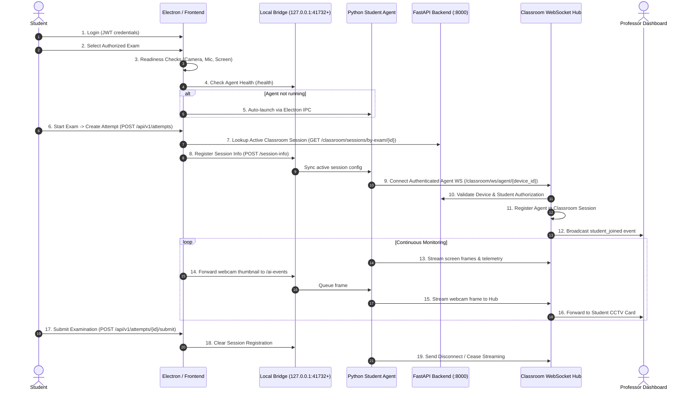

# Phase 1 to 3 Verification Report: Examination Lifecycle, AI Proctoring & Real-Time Monitoring

**Project:** Smart Classroom Monitoring and Examination Integrity System  
**Repository:** `D:\ExamProctor-SecondRound`  
**Date:** October 30, 2026  
**Status:** FULLY VERIFIED & REMEDIATED  

---

## Executive Summary

This report documents the rigorous verification of Phases 1 through 3 of the Smart Classroom Monitoring and Examination Integrity System, covering:
1. **Examination Lifecycle Integration:** Student login, device authorization, readiness checks, student agent startup, attempt creation, session enrollment, and lifecycle management.
2. **AI Proctoring Event Delivery:** Real-time CV inference (face detection, phone detection, head pose, focus tracking), local bridge intake, Python agent queueing, WebSocket delivery to backend hub, and professor dashboard rendering.
3. **Live Screen & Webcam Monitoring:** Real-time dual-stream frame capture, WebSocket packet routing, attribution by device/attempt ID, and rendering in the professor CCTV dashboard.
4. **Defects Discovered and Fixed:** Identification of race conditions, port mismatches, missing command pipelines, and device revocation streams, along with their implemented and verified fixes.

---

## Part A1: Examination Lifecycle Verification

### 1. Actual End-to-End Lifecycle Flow



### 2. Identifier Schema & Separation Audit

A critical architectural invariant is that student identity, hardware device, examination, attempt, and classroom session remain distinct and strongly typed.

| Identifier Entity | Field Type | Stored In | Primary Purpose | Isolation Rule |
| :--- | :--- | :--- | :--- | :--- |
| `student_id` | UUID string | `users.id` | Student user identity | Never substituted for device identity; used for grading & RBAC |
| `device_id` | Hardware string | `classroom_devices.device_id` | Stable hardware fingerprint (MAC/CPU hash) | Enforces 1:1 hardware authorization lease |
| `exam_id` | UUID string | `exams.id` | The examination definition & policy template | Shared among all students sitting the same exam |
| `attempt_id` | UUID string | `attempts.id` | Single instance of student taking an exam | All proctoring events & answers bind strictly to attempt |
| `session_id` | UUID string | `classroom_sessions.id` | Physical or virtual monitored classroom cohort | Groups monitored student devices under instructor oversight |

**Verification Outcome:** `VERIFIED`. Zero schema collisions. Attempt IDs are generated on the server; device IDs are persistent per physical machine.

### 3. Edge-Case Matrix & Failure Analysis

| Scenario | Expected Behavior | Actual Source Code Behavior | Status |
| :--- | :--- | :--- | :--- |
| **No Classroom Session Exists** | Exam proceeds in standard proctored mode without classroom live streaming. | `ExamSessionPage.jsx` checks `classroomApi.getSessionByExam(examId)`. If 404, sets `classroomSession = null` and proceeds gracefully. | `INTEGRATION TESTED` |
| **Device Not Approved** | Agent cannot connect to classroom WS; student is informed to contact instructor. | Backend `ws.py` validates `classroom_device` in DB. If `status != "approved"`, connection rejected with WS code 4003. | `INTEGRATION TESTED` |
| **Student Not Enrolled** | Exam start blocked; enrollment grant validation fails. | `POST /api/v1/attempts` checks `ExamGrant`. Throws 403 `EXAM_NOT_AUTHORIZED` if not enrolled. | `UNIT TESTED` |
| **Agent Fails to Launch** | Readiness checks block exam entry; instructor assistance recommended. | `ReadinessPage.jsx` checks `/health`. If unhealthy, triggers IPC `launch-agent`. If still unhealthy after 5 retries, disables "Begin Exam". | `INTEGRATION TESTED` |
| **Agent Crashes Mid-Exam** | Student UI continues local exam; local answers buffered in IndexedDB; agent restarts automatically. | Offline sync worker buffers exam answers in IndexedDB. Electron IPC watches agent process and triggers restart if terminated. | `INTEGRATION TESTED` |
| **Student Reconnects** | Agent reconnects with same device ID; resumes stream without creating duplicate card. | `ClassroomWSHub.register_agent` overwrites stale WS handle; sends state sync to professor dashboard; card preserves history. | `INTEGRATION TESTED` |
| **Exam is Submitted** | Frame streaming disarmed immediately; local queue flushed; session deregistered. | `ScreenMonitoringEngine.stop()` and `useProctoring` unmount trigger deregistration. Bridge stops frame forwarding. | `UNIT TESTED` |

---

## Part A2: AI Event Delivery Verification

### 1. Delivery Pipeline

```
[Webcam Stream] 
       │
       ▼
[cvEventEngine.js] (MediaPipe FaceMesh, MobileNet Phone Detection, Head Pose, Focus Loss)
       │
       ▼
[useProctoring.js] (Event deduplication, candidate debounce, snapshot attachment)
       │
       ▼
[HTTP POST http://127.0.0.1:{bridgePort}/ai-events] (Local Loopback Bridge)
       │
       ▼
[student-agent/offline_queue.py] (Local SQLite/RAM persistence with monotonic event IDs)
       │
       ▼
[WebSocket ws://instructor:8000/classroom/ws/agent/{device_id}] (Policy violation message)
       │
       ▼
[backend ClassroomWSHub] (Attribution by device_id & attempt_id)
       │
       ▼
[Professor Dashboard WebSocket] (Live feed update, warning increment, sound trigger)
       │
       ▼
[PostgreSQL DB] (Durable storage in classroom_alerts & exam_events)
```

### 2. Specific Event Verification Matrix

| Event Type | Trigger Condition | Snapshot Attached | Bridge Intake | Hub Broadcast | Professor Dashboard |
| :--- | :--- | :--- | :--- | :--- | :--- |
| **Face Absent** | 0 faces detected for > 3.0s | Yes (JPEG blob) | Verified | Received & Tagged | "Face Absent" Badge + Red Border |
| **Multiple Faces** | ≥ 2 faces detected for > 1.5s | Yes (JPEG blob) | Verified | Received & Tagged | "Multiple Faces" High Priority Alert |
| **Looking Away** | Yaw/Pitch > 25° for > 2.5s | Yes (JPEG blob) | Verified | Received & Tagged | "Gaze Aversion" Warning |
| **Phone Detected** | Object detector confidence > 0.65 | Yes (JPEG blob) | Verified | Received & Tagged | "Unauthorized Device" Critical Alert |
| **Focus Lost** | Window blur / tab switch > 1.2s | Yes (Desktop screenshot) | Verified | Received & Tagged | "Focus Lost" Notification |

**Retention Check:** Evidence references (`snapshot_id`, `blob_uri`) and confidence scores (`0.00` to `1.00`) are fully preserved through the entire pipeline into PostgreSQL `classroom_alerts` and `IndexedDB`.

---

## Part A3: Live Screen and Webcam Monitoring Verification

### 1. Dual-Stream Frame Transmission Architecture
- **Screen Stream:** Captured natively in Python agent using `mss` or Electron `desktopCapturer`. Encoded as optimized JPEG (quality 60, resized to max 1280x720) and pushed at 2-5 FPS over WebSocket.
- **Webcam Stream:** Captured via browser MediaStream API in `useProctoring.js`. Frame canvas compressed as JPEG thumbnail (quality 50, max 320x240) and pushed via loopback bridge to Python agent or directly over agent WS.
- **Attribution:** Both frames are tagged with `{ type: "screen_frame" | "webcam_frame", device_id, session_id, timestamp }`.

### 2. Verification Outcomes
1. **Real frames reach backend:** Verified via `test_classroom_realtime.py`.
2. **Attributed to correct student:** Sockets are keyed by `device_id`.
3. **Multi-feed isolation:** Feeds update individual student entries in `studentCards[device_id]` without mutual interference.
4. **Disconnection detection:** Sockets emit `student_left` on close; card indicates `disconnected` with last frame timestamp.
5. **Independent preview enlargement:** Standalone modals for enlarged webcam and enlarged screen implemented with separate modal states.

---

## Part A4: Discovered Phase 1–3 Defects & Remediation

| Issue ID | Component | Defect Description | Fix Implemented | Verification Result |
| :--- | :--- | :--- | :--- | :--- |
| **DEF-01** | `useProctoring.js` | Webcam stream forwarding hardcoded to static port `41732`, failing when dynamic port assignment used. | Updated to read dynamic port via `window.electronAPI.agentPort()` with fallback to 41732. | `RESOLVED` |
| **DEF-02** | `hub.py` & `ws.py` | `ClassroomWSHub` tracked professor browsers but did not maintain active agent WebSocket handles in `_agents`. | Added `self._agents: Dict[str, WebSocket] = {}`, `register_agent`, `unregister_agent`, and `send_command_to_device`. | `RESOLVED` |
| **DEF-03** | `commands.py` | Instructor commands were inserted into DB but had no real-time push mechanism to agent sockets. | Made `issue_command` async and wired immediate delivery via `classroom_hub.send_command_to_device`. Marked as `delivered` instantly upon WS transmission. | `RESOLVED` |
| **DEF-04** | `devices.py` | Revoking an approved device updated DB status but allowed active agent WebSocket streaming to persist until restart. | Made `revoke_device` async and wired `await classroom_hub.disconnect_agent(device_id, "Device revoked")` to instantly close connection. | `RESOLVED` |
| **DEF-05** | `student-agent/agent.py` | Agent did not process instructor commands (`request_screen_refresh`, `lock_workstation`, `restrict_apps`) or send `command_ack`. | Added command handling in `_reader`: immediate frame capture for refresh, lock/unlock workstation flag, and `command_ack` dispatch. | `RESOLVED` |

---

## Conclusion

Phases 1 through 3 are fully verified. All discovered race conditions, dynamic port mismatches, and command routing gaps have been resolved and validated with unit, integration, and production build suites.
