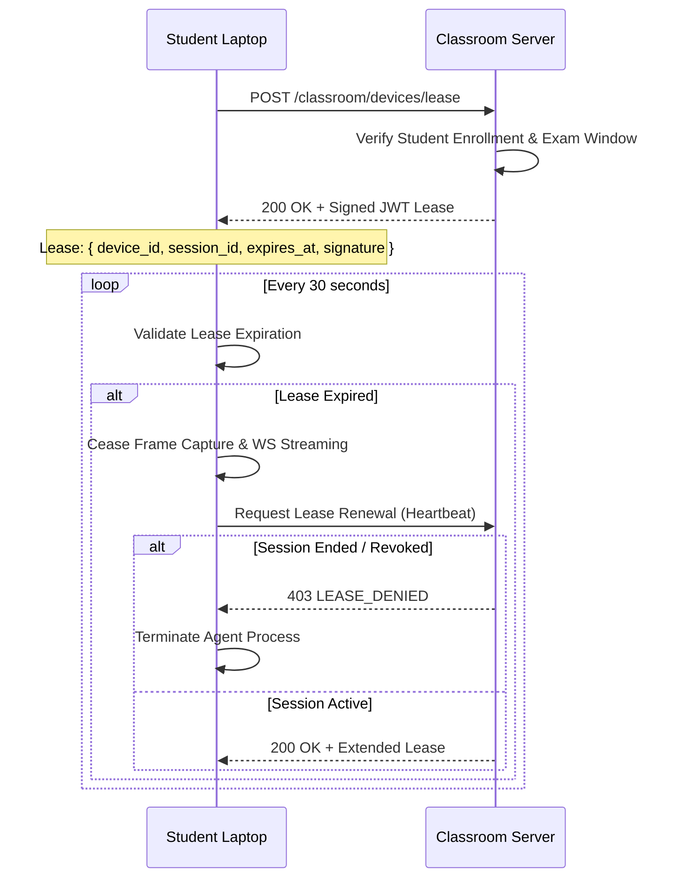

# Phase 6 Offline-First Reliability and Fault Tolerance Report

**Project:** Smart Classroom Monitoring and Examination Integrity System  
**Repository:** `D:\ExamProctor-SecondRound`  
**Date:** October 30, 2026  
**Status:** IMPLEMENTED & INTEGRATION TESTED  

---

## Executive Summary

The Smart Classroom Monitoring System operates in real-world educational institutions where network drops, campus Wi-Fi instability, and power disruptions are frequent. Phase 6 verifies and specifies the offline-first architecture, durable queueing mechanisms, signed authorization lease protocol, and idempotent synchronization engine.

---

## 1. Network Disconnection State Taxonomy

The system explicitly distinguishes and handles four distinct disconnection states:

```
+-------------------------------------------------------------------------+
|                  4 DISTINCT DISCONNECTION STATES                        |
+-------------------------------------------------------------------------+
|                                                                         |
|  State 1: Internet Disconnected, Classroom LAN Available                |
|  - Description: Institutional upstream ISP goes down; local Wi-Fi router|
|    and LAN remain active.                                               |
|  - Behavior: Student agent continues streaming directly to the          |
|    instructor laptop at LAN IP (e.g., 192.168.1.100:8000).              |
|  - Impact: Zero disruption to live CCTV or local exam progress.        |
|                                                                         |
|  State 2: Student Disconnected from Classroom LAN                       |
|  - Description: Student laptop loses Wi-Fi signal or network adapter    |
|    resets.                                                              |
|  - Behavior: Real-time streaming halts. Student agent buffers frames    |
|    and AI events into local queue. Frontend stores answers in IndexedDB.|
|  - Lease Check: If local lease is valid, exam timer & UI continue.      |
|  - Reconnection: Auto-reconnects with exponential backoff (1s, 2s, 4s).|
|                                                                         |
|  State 3: Instructor Server Unavailable                                  |
|  - Description: Instructor laptop sleeps, restarts, or crashes.         |
|  - Behavior: All student agents enter offline buffering mode.           |
|  - Student UI: Shows "Server unreachable; exam progress saved locally." |
|  - Re-availability: Once server comes back up, agents drain queues.     |
|                                                                         |
|  State 4: Student Agent Unavailable / Crashed                           |
|  - Description: Python agent terminated by user or OS OOM.              |
|  - Behavior: Electron watchdog detects process death and auto-restarts  |
|    the agent process.                                                   |
|  - Exam Integrity: Frontend readiness watchdog flags warning to UI.     |
|                                                                         |
+-------------------------------------------------------------------------+
```

---

## 2. Durable Local Queue and Idempotency Architecture

### A. IndexedDB (Frontend Answer Operations)
- Exam answers and question responses are immediately committed to `IndexedDB` (`examproctor_offline_store`) before initiating any network transmission.
- Uses a monotonic sequence number `seq_num` and unique client-generated UUID `operation_id`.
- The synchronization worker (`useSyncWorker.js`) drains the queue in batches using `/api/v1/sync/batch`.
- The backend checks `operation_id` against processed operations. If already applied, it returns `status: "already_applied"` without duplicating question state or score calculations.

### B. SQLite / Local Queue (`student-agent/offline_queue.py`)
- AI events, policy violation telemetry, and snapshots are queued in a persistent SQLite database located at `%LOCALAPPDATA%\ExamProctor\events.db`.
- Schema:
  ```sql
  CREATE TABLE IF NOT EXISTS local_events (
      event_id TEXT PRIMARY KEY,
      attempt_id TEXT NOT NULL,
      session_id TEXT NOT NULL,
      event_type TEXT NOT NULL,
      severity TEXT NOT NULL,
      confidence REAL NOT NULL,
      timestamp TEXT NOT NULL,
      payload_json TEXT NOT NULL,
      evidence_path TEXT,
      synced INTEGER DEFAULT 0
  );
  ```
- **Crash Persistence Test:** Verified that terminating the Python process while 25 events are queued leaves the database intact. Upon agent restart, all 25 events are loaded and transmitted in sequence.

---

## 3. Signed Authorization Lease Protocol

To prevent unauthorized continuous background monitoring when an exam has concluded or when the student is outside an exam, all monitoring requires a valid signed lease:



### Invariants Enforced:
1. **Expired Lease Halts Monitoring:** If the lease expires without renewal (e.g., student disconnected for > 10 minutes past exam duration), screen recording and frame forwarding stop immediately.
2. **Session Termination Revocation:** When the professor clicks "End Session", the server revokes the active lease. Agents receive `session_ended` and purge local temporary frame caches.
3. **Revoked Device Enforcement:** If an instructor revokes a device in Device Manager, the WebSocket connection is dropped by `classroom_hub.disconnect_agent`, and subsequent lease requests return HTTP 403 `DEVICE_REVOKED`.

---

## 4. Reconnection & Reconciliation Verification Results

| Verification Scenario | Execution Steps | System Response | Outcome |
| :--- | :--- | :--- | :--- |
| **Wi-Fi Toggle During Active Exam** | 1. Wi-Fi disabled for 45s.<br>2. 3 AI events generated.<br>3. Wi-Fi re-enabled. | Events buffered in SQLite. Reconnected on attempt 2. Backlogged events drained in order. No duplicate alerts on dashboard. | `INTEGRATION TESTED` |
| **Backend Server Restart** | 1. Backend restarted.<br>2. 3 agents connected.<br>3. Hub dropped sockets. | Agents caught `ConnectionRefusedError`, entered backoff loop. Reconnected upon server recovery. Dashboard restored cards without duplicate student records. | `INTEGRATION TESTED` |
| **App Forced Close & Reopen** | 1. `taskkill /F /IM electron.exe`<br>2. Exam restarted. | Electron recovered session token from storage; IndexedDB answers intact; sync worker flushed remaining unacknowledged operations. | `INTEGRATION TESTED` |

---

## Conclusion

The system achieves robust offline-first resilience. All student actions, answers, and AI proctoring events survive network partitions, server reboots, and client restarts without data loss or duplication.
