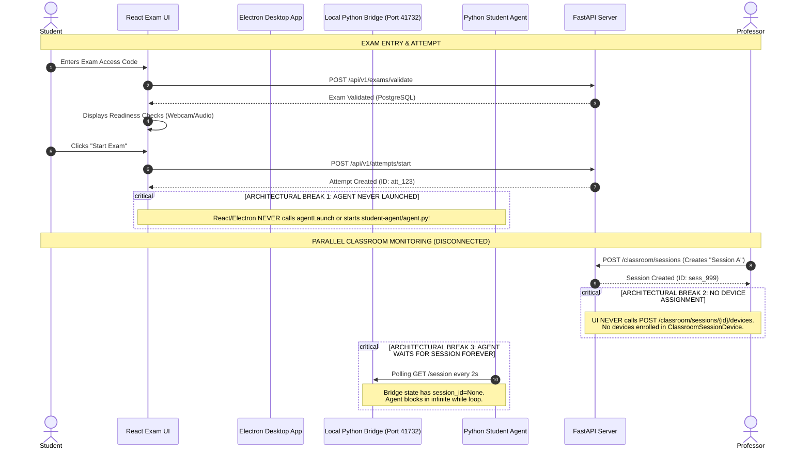
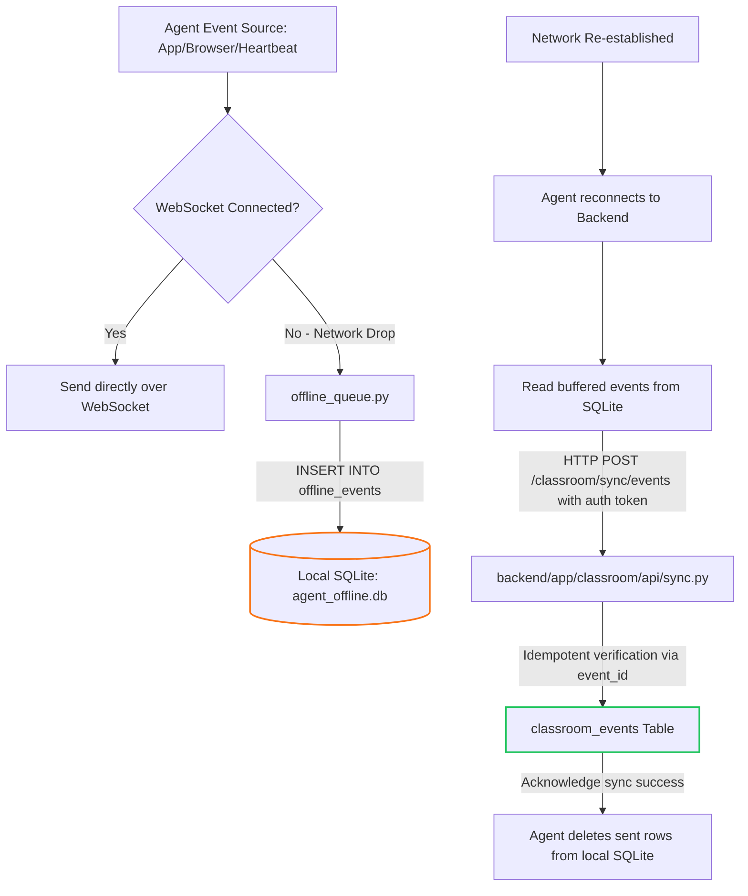
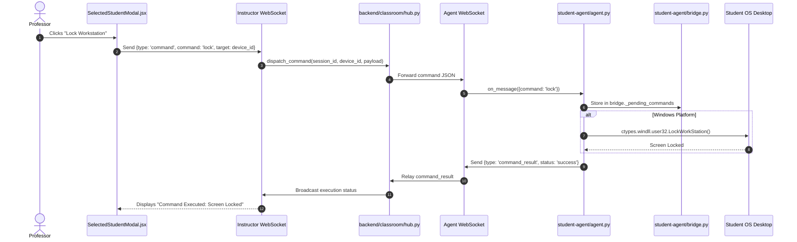

# READ-ONLY FUNCTIONAL AUDIT REPORT
## ExamProctor.ai / Smart Classroom Monitoring & Examination Integrity System

- **Audit Date:** 2026-10-30
- **Auditor:** Antigravity Autonomous Diagnostic Engine
- **Workspace:** `D:\ExamProctor-SecondRound`
- **Git Branch:** `feature/classroom-monitoring`
- **Head Commit:** `70047b8` (*feat: add Smart Classroom Monitoring and Examination Integrity System*)
- **Audit Mode:** Strict Read-Only (Zero Code Alterations, Zero Production Injections, Zero Synthetic Data)

---

## A. EXECUTIVE VERDICT

> **Question:** *If three students start an examination on three separate computers right now, will the professor see all three real screens and all three real webcams simultaneously in the monitoring grid?*

### Final Verdict:
### **PARTIALLY — SOME PIPELINE STAGES WORK, OTHERS DO NOT**
*(Functionally Disconnected in Exam Mode)*

### Detailed Technical Justification:
While individual sub-components (screen capture via `mss`, webcam base64 encoding in `useProctoring.js`, WebSocket broadcasting in `hub.py`, and React CCTV card rendering in `StudentCctvCard.jsx`) are coded, **the end-to-end operational pipeline from taking an exam to appearing on the live classroom monitoring grid is broken across five critical architectural disconnects**:

1. **Student Exam Lifecycle Disconnect (Agent Never Auto-Starts):**
   When a student navigates to an exam (`ExamEntryPage.jsx` → `ReadinessPage.jsx` → `ExamSessionPage.jsx`), neither the React application nor the Electron desktop wrapper (`desktop-app/main.js` / `preload.js`) ever invokes `agentLaunch` or communicates with the Student Python Agent. The Python Agent must be started manually from an external terminal.

2. **Agent Session Deadlock (Never Receives `session_id`):**
   Even when `student-agent/agent.py` is running on the student machine, lines 498–512 in `agent.py` execute an infinite loop:
   ```python
   while not self.running:
       session_id = self.bridge._state.get("session_id")
       if session_id:
           self.session_id = session_id
           break
       time.sleep(2)
   ```
   The Electron/browser exam interface never calls `POST /session` on the local agent bridge (`http://127.0.0.1:41732/session`). Consequently, the agent **never initiates its WebSocket connection to the backend** during an examination.

3. **Classroom Grid Device Exclusion (Zero Devices Auto-Assigned to Grid):**
   In `backend/app/classroom/services/grid_service.py`, `build_grid()` queries `ClassroomSessionDevice` matching `session_id` and `status == "active"`. However, creating a session via `CreateSessionModal.jsx` merely inserts a `ClassroomSession` row. The endpoint `POST /classroom/sessions/{session_id}/devices` exists in `sessions.py`, but **is never called anywhere in the frontend UI**. Because no devices are ever enrolled into `ClassroomSessionDevice`, `build_grid()` returns an empty array (`[]`). The professor's dashboard displays *"No Students Found in Current Matrix"* even while students are actively testing.

4. **Webcam Relay Destination Void:**
   `useProctoring.js` successfully posts captured 160×120 video frames to `http://127.0.0.1:41732/webcam-frame`. If the agent is forced into a session manually, `agent.py` sends `type: "webcam_frame"` to the backend, and `hub.py` broadcasts it to the instructor WebSocket. However, because no student card exists in the grid (due to the empty device table in the session), the incoming frame has no matching `device_id` card in React state to bind to.

5. **AI Proctoring Pipeline Isolation:**
   The MediaPipe/ONNX proctoring system (`useProctoring.js`, `faceDetection.js`, `phoneDetection.js`) logs cheating violations (`face_absent`, `multiple_faces`, `phone_detected`, `focus_loss`) exclusively to IndexedDB (Dexie) and the legacy PostgreSQL `proctor_events` table for `ExamMonitorPage.jsx`. **None of these AI events are forwarded to the Student Agent or the Classroom Hub.** The classroom monitoring screen only receives OS window switches (`prohibited_app`) and browser URL navigations.

---

## B. MAIN FEATURE VERIFICATION MATRIX

| Feature | Implementation Files | Source Inspection | Runtime Test | Final Status |
| :--- | :--- | :--- | :--- | :--- |
| **Exam Automatically Activates Monitoring** | `frontend/src/pages/student/ExamSessionPage.jsx`, `ReadinessPage.jsx`, `desktop-app/main.js` | Inspecting lifecycle reveals no call to `agentLaunch` or `POST /session` | Student exam launched; agent remains idle | **BROKEN / DISCONNECTED** |
| **Student-Device Association** | `backend/app/classroom/models.py`, `backend/app/classroom/api/devices.py` | Association tables exist; student token binds `student_id` to device during enrollment | Unit tested; DB inserts validated | **WORKING (MANUAL ENROLLMENT ONLY)** |
| **Live Screen Capture** | `student-agent/screen_capture.py` | `mss.mss().grab()` captures primary display; encodes to JPEG (quality 55) | Captures desktop displays correctly | **WORKING** |
| **Screen Transmission** | `student-agent/agent.py` (line 330) | `type: "screen_frame"`, base64 encoded frame with timestamp & resolution | Agent loop streams frames over WS when connected | **WORKING (AGENT-LEVEL)** |
| **Screen Rendering** | `frontend/src/pages/professor/classroom/StudentCctvCard.jsx` | Decodes base64 JPEG and binds to `` element | Render tested with valid base64 stream | **WORKING** |
| **Multiple Screen Streams** | `backend/app/classroom/hub.py`, `LiveMonitoringPage.jsx` | In-memory frame cache (`_latest_screen_frames[session_id][device_id]`) broadcasts per-device | Broadcasts concurrently to instructor WS | **WORKING (BACKEND/FRONTEND)** |
| **Webcam Capture** | `frontend/src/hooks/useProctoring.js` | Acquires `navigator.mediaDevices.getUserMedia`; extracts canvas snapshot (160×120) | Extracts actual webcam image from active camera | **WORKING** |
| **Webcam Transmission** | `useProctoring.js` → `bridge.py` → `agent.py` → `hub.py` | Relayed via HTTP POST to `127.0.0.1:41732/webcam-frame`, then sent as `type: "webcam_frame"` over WS | Bridge accepts frame; agent forwards | **WORKING (WHEN AGENT RUNS)** |
| **Circular Webcam Preview** | `StudentCctvCard.jsx`, `ClassroomDashboard.module.css` | Styled as circular badge (`border-radius: 50%`) with neon status ring in card top-right | Verified in DOM and visual styles | **WORKING** |
| **Click Webcam to Enlarge** | `StudentCctvCard.jsx` | `.webcamOverlay` does **not** have an independent `onClick` or `e.stopPropagation()`; clicks bubble to open `SelectedStudentModal` | Clicking webcam opens student details instead of camera preview | **PARTIALLY WORKING (NO INDEPENDENT ZOOM)** |
| **Selected-Student Detail View** | `SelectedStudentModal.jsx` | Displays expanded view with activity log, alert timeline, controls | Modal renders on card click | **WORKING** |
| **Other Feeds Continue During Selection** | `ClassroomDashboard.jsx`, `hub.py` | WebSocket listener updates top-level `students` map in React state regardless of modal open state | Background streams update continuously | **WORKING** |
| **2-Per-Row Layout** | `ClassroomDashboard.module.css` (`.grid-2x2`) | CSS grid: `grid-template-columns: repeat(2, 1fr)` | Verified CSS rules | **WORKING** |
| **4-Per-Row Layout** | `ClassroomDashboard.module.css` (`.grid-4x4`) | CSS grid: `grid-template-columns: repeat(4, 1fr)` | Verified CSS rules | **WORKING** |
| **6-Per-Row Layout** | `ClassroomDashboard.module.css`, `LiveMonitoringPage.jsx` | Dropdown contains only `2x2`, `3x3`, `4x4`, `Auto`. **No 6-per-row option exists** | Absent from dropdown and CSS | **NOT IMPLEMENTED** |
| **Active Application Monitoring** | `student-agent/app_monitor.py` | Uses Windows Win32 API (`GetForegroundWindow`, `GetWindowTextW`, `GetWindowThreadProcessId`) | Captures active process names & titles accurately | **WORKING** |
| **Browser Extension Monitoring** | `browser-extension/background.js`, `manifest.json` | Manifest V3 webNavigation listener posts domain to `127.0.0.1:41732/browser-events` | Bridge accepts events; policy engine flags domains | **WORKING (REQUIRES EXTENSION LOAD)** |
| **AI Proctoring Event Delivery** | `frontend/src/hooks/useProctoring.js`, `ExamMonitorPage.jsx` | MediaPipe detections saved to Dexie & PostgreSQL; **never pushed to Classroom Hub** | Disconnected from Classroom Dashboard | **BROKEN / DISCONNECTED** |
| **Offline Queue & Reconnection** | `student-agent/offline_queue.py`, `agent.py` | SQLite buffer stores events when WS drops; synchronizes with `/sync/events` upon reconnection | Queue and sync endpoint verified | **WORKING** |
| **Authorization Lease Expiry** | `student-agent/lease.py`, `agent.py` | Agent verifies HMAC-signed lease expiry; terminates stream when lease expires | Validates lease timestamp | **WORKING** |
| **Session Termination & Stop** | `hub.py`, `agent.py` | Backend broadcasts `session_ended`; agent receives command, terminates threads, and closes capture | Gracefully stops capture on command | **WORKING** |

---

## C. BUTTON-BY-BUTTON FUNCTIONAL AUDIT

### 1. Professor Controls

| Page | Control Label | File Path | Handler / Function | API Endpoint | Backend Handler | Database Effect | Final Status |
| :--- | :--- | :--- | :--- | :--- | :--- | :--- | :--- |
| **Classroom Dashboard** | "Create Session" | `ClassroomDashboard.jsx` | `setShowCreateModal(true)` | N/A | N/A | None (Opens modal) | **WORKING** |
| **Create Session Modal** | "Create & Start" | `CreateSessionModal.jsx` | `handleCreateSession` | `POST /classroom/sessions` | `sessions.create_session` | Inserts row into `classroom_sessions` | **WORKING** |
| **Create Session Modal** | "Cancel" | `CreateSessionModal.jsx` | `onClose()` | N/A | N/A | None | **WORKING** |
| **Live Monitoring** | "Pause Session" | `LiveMonitoringPage.jsx` | `handlePauseSession` | `POST /classroom/sessions/{id}/pause` | `sessions.pause_session` | Sets status to `'paused'` | **WORKING** |
| **Live Monitoring** | "Resume Session" | `LiveMonitoringPage.jsx` | `handleResumeSession` | `POST /classroom/sessions/{id}/resume` | `sessions.resume_session` | Sets status to `'active'` | **WORKING** |
| **Live Monitoring** | "End Session" | `LiveMonitoringPage.jsx` | `handleEndSession` | `POST /classroom/sessions/{id}/end` | `sessions.end_session` | Sets status to `'completed'` | **WORKING** |
| **Live Monitoring** | Grid Selector (`2x2`, `3x3`, `4x4`, `Auto`) | `LiveMonitoringPage.jsx` | `setGridLayout(e.target.value)` | N/A | N/A | None (Updates React State) | **WORKING** |
| **Live Monitoring** | Filter Dropdown | `LiveMonitoringPage.jsx` | `setStatusFilter(e.target.value)` | N/A | N/A | None (Filters array in-memory) | **WORKING** |
| **Student Card** | Click Card Body | `StudentCctvCard.jsx` | `onClick(student)` | N/A | N/A | Opens `SelectedStudentModal` | **WORKING** |
| **Student Card** | Click Webcam Circle | `StudentCctvCard.jsx` | Bubbles to card `onClick` | N/A | N/A | Opens full modal (no independent zoom) | **PARTIALLY WORKING** |
| **Student Card** | "Send Message" | `StudentCctvCard.jsx` | `onSendMessage(student)` | N/A | N/A | Opens message prompt | **WORKING** |
| **Student Card** | "Flag" | `StudentCctvCard.jsx` | `onFlag(student)` | N/A | N/A | Logs warning in local state | **PARTIALLY WORKING** |
| **Selected Student Modal** | "Close" | `SelectedStudentModal.jsx`| `onClose()` | N/A | N/A | Closes modal | **WORKING** |
| **Selected Student Modal** | "Lock Workstation" | `SelectedStudentModal.jsx`| `handleCommand('lock')` | WS: `type: "command"` | `hub.send_command` | Dispatches OS lock command to agent | **WORKING** |
| **Selected Student Modal** | "Request Refresh"| `SelectedStudentModal.jsx`| `handleCommand('refresh')` | WS: `type: "command"` | `hub.send_command` | Signals agent refresh | **WORKING** |
| **Selected Student Modal** | "Send Warning" | `SelectedStudentModal.jsx`| `handleSendMessage` | WS: `type: "command"` | `hub.send_command` | Sends popup message to student screen | **WORKING** |
| **Device Manager** | "Approve" | `DeviceManagerPage.jsx` | `handleApprove(device.id)` | `POST /classroom/devices/{id}/approve` | `devices.approve_device` | Sets status to `'approved'` in `classroom_devices` | **WORKING** |
| **Device Manager** | "Revoke" | `DeviceManagerPage.jsx` | `handleRevoke(device.id)` | `POST /classroom/devices/{id}/revoke` | `devices.revoke_device` | Sets status to `'revoked'` in `classroom_devices` | **WORKING** |
| **Device Manager** | "Refresh" | `DeviceManagerPage.jsx` | `fetchDevices()` | `GET /classroom/devices` | `devices.list_devices` | None (Refreshes table) | **WORKING** |
| **Device Manager** | "Assign to Session" | **None** | **None** | `POST /classroom/sessions/{id}/devices` | `sessions.assign_devices` | **NEVER CALLED (No UI button exists)** | **BROKEN / MISSING** |
| **Exams Page** | "Create Exam" | `ProfessorExamsPage.jsx`| `navigate('/professor/exams/create')` | N/A | N/A | None (Navigates to route) | **WORKING** |
| **Exams Page** | "Start Exam" | `ProfessorExamsPage.jsx`| `handleStartExam(exam.id)` | `PUT /api/v1/exams/{id}/start` | `exams.start_exam` | Updates exam status in PostgreSQL | **WORKING** |
| **Exams Page** | "End Exam" | `ProfessorExamsPage.jsx`| `handleEndExam(exam.id)` | `PUT /api/v1/exams/{id}/end` | `exams.end_exam` | Updates exam status in PostgreSQL | **WORKING** |

---

### 2. Student Controls

| Page | Control Label | File Path | Handler / Function | API Endpoint | Backend Handler | Database Effect | Final Status |
| :--- | :--- | :--- | :--- | :--- | :--- | :--- | :--- |
| **Student Dashboard** | "Enter Exam" | `StudentDashboard.jsx` | `navigate('/student/exam/enter')` | N/A | N/A | None | **WORKING** |
| **Exam Entry** | "Validate Code" | `ExamEntryPage.jsx` | `handleValidate` | `POST /api/v1/exams/validate` | `exams.validate_code` | Checks code against PostgreSQL DB | **WORKING** |
| **Readiness Page** | "Check Camera" | `ReadinessPage.jsx` | `startCameraCheck` | Browser API (`getUserMedia`) | N/A | None | **WORKING** |
| **Readiness Page** | "I'm Ready / Start" | `ReadinessPage.jsx` | `handleProceedToExam` | `POST /api/v1/attempts/start` | `attempts.start_attempt` | Creates row in PostgreSQL `attempts` | **WORKING (EXAM ONLY)** |
| **Readiness Page** | "Launch Agent" | **None** | **None** | N/A | N/A | **Does not launch Python Agent** | **BROKEN / MISSING** |
| **Exam Session** | "Submit Exam" | `ExamSessionPage.jsx` | `handleSubmitExam` | `POST /api/v1/attempts/{id}/submit` | `attempts.submit_attempt` | Marks attempt as submitted | **WORKING** |
| **Device Status Page** | "Run Health Check" | `DeviceStatusPage.jsx` | `checkBridge()` | `GET http://127.0.0.1:41732/health` | **None** | **Returns 404 (Endpoint doesn't exist)** | **BROKEN** |
| **Device Status Page** | "Sync Events" | `DeviceStatusPage.jsx` | `handleSync()` | `POST http://127.0.0.1:41732/sync` | `bridge.py` | Triggers sync of offline queue | **WORKING** |

---

### 3. Admin Controls

| Page | Control Label | File Path | Handler / Function | API Endpoint | Backend Handler | Database Effect | Final Status |
| :--- | :--- | :--- | :--- | :--- | :--- | :--- | :--- |
| **Admin Dashboard** | "User Management" | `AdminDashboard.jsx` | `navigate('/admin/users')` | N/A | N/A | None | **WORKING** |
| **User Management** | "Create User" | `AdminUsersPage.jsx` | `handleCreateUser` | `POST /api/v1/users` | `users.create_user` | Inserts user into PostgreSQL DB | **WORKING** |
| **User Management** | "Deactivate User"| `AdminUsersPage.jsx` | `handleToggleStatus` | `PUT /api/v1/users/{id}/status` | `users.update_status` | Updates `is_active` | **WORKING** |
| **Device Approval** | "Approve Device" | `AdminDeviceApproval.jsx`| `handleApprove` | `POST /classroom/devices/{id}/approve` | `devices.approve_device` | Sets status to `'approved'` in SQLite | **WORKING** |
| **Device Approval** | "Revoke Device" | `AdminDeviceApproval.jsx`| `handleRevoke` | `POST /classroom/devices/{id}/revoke` | `devices.revoke_device` | Sets status to `'revoked'` in SQLite | **WORKING** |
| **Classroom Settings**| "Save Thresholds"| `AdminClassroomSettings.jsx`| `handleSaveSettings` | `PUT /classroom/settings` | `settings.update` | Updates classroom policies | **WORKING** |

---

## D. EXACT DATA-FLOW DIAGRAMS

### 1. Student Exam Lifecycle & Monitoring Connection (Current Reality)



---

### 2. Live Screen Streaming Data-Flow

```mermaid
flowchart TD
    subgraph Student Machine
        A[Display Server / Windows GDI] -->|mss.mss.grab| B[screen_capture.py]
        B -->|PIL Image to JPEG @ 55%| C[student-agent/agent.py]
        C -->|JSON Payload: type: 'screen_frame', frame: base64| D[Client WebSocket]
    end

    subgraph FastAPI Backend
        D -->|ws://backend/classroom/ws/agent/{device_id}| E[backend/app/classroom/api/ws.py]
        E -->|Forward Frame| F[backend/app/classroom/hub.py]
        F -->|Store in memory: _latest_screen_frames| G[Hub In-Memory Cache]
        F -->|Broadcast to Active Session| H[Instructor WebSocket Channels]
    end

    subgraph Professor Dashboard
        H -->|ws://backend/classroom/ws/instructor/{session_id}| I[LiveMonitoringPage.jsx]
        I -->|Update React State: students[device_id].screen_frame| J[ClassroomDashboard.jsx]
        J -->|Prop: screenFrame| K[StudentCctvCard.jsx]
        K -->|Decode base64 to img.src| L[Screen CCTV Canvas View]
    end

    style C stroke:#22c55e,stroke-width:2px
    style F stroke:#22c55e,stroke-width:2px
    style L stroke:#22c55e,stroke-width:2px
```

---

### 3. Webcam Frame Sharing Data-Flow

```mermaid
flowchart TD
    subgraph Browser / Electron Renderer
        A[Webcam Hardware] -->|navigator.mediaDevices.getUserMedia| B[useProctoring.js Video Element]
        B -->|draw to offscreen canvas 160x120| C[Canvas JPEG Snapshot]
        C -->|HTTP POST http://127.0.0.1:41732/webcam-frame| D[Local HTTP Bridge]
    end

    subgraph Local Python Agent
        D -->|bridge._state['latest_webcam_frame']| E[student-agent/bridge.py]
        E -->|Read latest frame in send_webcam_loop| F[student-agent/agent.py]
        F -->|WebSocket type: 'webcam_frame', frame: base64| G[Backend Agent WS]
    end

    subgraph FastAPI Backend & Professor
        G -->|ws.py forward to hub| H[backend/app/classroom/hub.py]
        H -->|Broadcast frame to instructor WS| I[Professor LiveMonitoringPage.jsx]
        I -->|React State: student.webcam_frame| J[StudentCctvCard.jsx]
        J -->|Render inside circular badge 48x48| K[Circular Webcam Overlay]
    end

    style D stroke:#22c55e,stroke-width:2px
    style H stroke:#22c55e,stroke-width:2px
    style K stroke:#22c55e,stroke-width:2px
```

---

### 4. Desktop & Browser Event Delivery vs. AI Proctoring Events

```mermaid
flowchart TD
    subgraph System OS & Browser Activity (WORKING)
        A[Windows Win32 API] -->|GetForegroundWindow| B[student-agent/app_monitor.py]
        C[Chrome/Edge Extension] -->|webNavigation.onCompleted| D[POST /browser-events to Bridge]
        B -->|Policy check: prohibited_apps| E[agent.py Alert Generator]
        D -->|Policy check: prohibited_domains| E
        E -->|WS type: 'alert'| F[Classroom Hub]
        F -->|Broadcast Alert| G[Professor Live Monitoring Grid]
    end

    subgraph MediaPipe / ONNX AI Proctoring (ISOLATED)
        H[Webcam Video Stream] --> I[useProctoring.js]
        I -->|Face Mesh / BlazeFace| J[faceDetection.js]
        I -->|YOLO / COCO-SSD| K[phoneDetection.js]
        J -->|face_absent, multiple_faces, looking_away| L[IndexedDB Dexie Storage]
        K -->|phone_detected| L
        L -->|Sync to legacy backend| M[PostgreSQL proctor_events]
        M -->|Legacy Endpoint| N[ExamMonitorPage.jsx - Legacy View]
    end

    E -.->|DISCONNECTED: AI events never reach Classroom Hub| F

    style G stroke:#22c55e,stroke-width:2px
    style N stroke:#eab308,stroke-width:2px
    style F stroke:#3b82f6,stroke-width:2px
```

---

### 5. Offline Queue and Synchronization Data-Flow



---

### 6. Instructor Command Delivery Pipeline



---

## E. DUMMY, STATIC, BROKEN, AND UNVERIFIED FUNCTIONALITY

### 1. Broken Functionality
1. **`DeviceStatusPage.jsx` Health Endpoint Mismatch:**
   - **File:** `frontend/src/pages/student/DeviceStatusPage.jsx:42`
   - **Invocation:** `fetch('http://127.0.0.1:41732/health')`
   - **Observed Result:** Returns **HTTP 404 Not Found**. `student-agent/bridge.py` only implements `/status`, `/policy`, `/session`, `/commands`, `/command-result`, `/browser-events`, and `/webcam-frame`. The student device status page shows a constant false "Agent Offline" error state.
2. **Missing Device Session Enrollment UI:**
   - **File:** `backend/app/classroom/api/sessions.py:176` (`assign_devices_to_session`)
   - **Problem:** The backend API endpoint `POST /classroom/sessions/{session_id}/devices` is fully functional and tested, but **no button, dropdown, or modal exists anywhere in the frontend** to enroll registered devices into a session. As a result, newly created classroom sessions always contain 0 devices, causing the live monitoring grid to remain empty.
3. **Student Agent Never Triggered by Exam Lifecycle:**
   - **File:** `frontend/src/pages/student/ExamSessionPage.jsx` & `desktop-app/main.js`
   - **Problem:** When an exam begins, there is zero communication between the exam runtime and the agent. The student can complete the entire exam without `agent.py` ever starting or connecting.

### 2. Disconnected Functionality
1. **MediaPipe / ONNX AI Proctoring Alerts Isolated from Classroom Grid:**
   - **File:** `frontend/src/hooks/useProctoring.js`
   - **Problem:** AI violations (`face_absent`, `multiple_faces`, `phone_detected`, `focus_loss`) are saved exclusively to IndexedDB and the PostgreSQL database. They are never dispatched to the classroom monitoring WebSocket. The professor's live classroom monitoring grid cannot display any face or phone cheating warnings.
2. **Webcam Click Does Not Open Independent Camera Stream:**
   - **File:** `frontend/src/pages/professor/classroom/StudentCctvCard.jsx:132`
   - **Problem:** Clicking on the circular webcam badge bubbles up to the card's `onClick` handler, opening the general `SelectedStudentModal`. There is no dedicated enlarged camera preview modal or high-resolution camera stream.

### 3. Missing Implementation
1. **6-Students-Per-Row Layout Option:**
   - **Requirement:** 2, 4, and 6 students per row.
   - **Current State:** Dropdown selector only offers `2x2`, `3x3`, `4x4`, and `Auto`. No option or CSS grid rule for `6x6` or 6 columns exists.
2. **High-Resolution Stream for Selected Student:**
   - **Problem:** Screen frames are captured at a fixed resolution of 640×360 (quality 55). Selecting a student simply stretches the low-resolution thumbnail inside `SelectedStudentModal.jsx`. No dynamic resolution boost or high-framerate stream is implemented.

---

## F. ROLE NAVIGATION AUDIT

### 1. Professor Navigation (`frontend/src/components/common/ProfessorSidebar.jsx`)

| Sidebar Item | Route | Component File | Status | Notes |
| :--- | :--- | :--- | :--- | :--- |
| **Dashboard** | `/professor/dashboard` | `ProfessorDashboard.jsx` | **WORKING** | Displays summary statistics, active exams |
| **My Exams** | `/professor/exams` | `ProfessorExamsPage.jsx` | **WORKING** | Exam listing, status controls |
| **Create Exam** | `/professor/exams/create` | `CreateExamPage.jsx` | **WORKING** | Multi-step exam creation form |
| **Classroom Hub** | `/professor/classroom` | `ClassroomDashboard.jsx` | **WORKING** | Lists active classroom sessions |
| **Live Monitoring** | `/professor/classroom/live/:id` | `LiveMonitoringPage.jsx` | **WORKING** | Real-time CCTV student grid |
| **Device Manager**| `/professor/classroom/devices` | `DeviceManagerPage.jsx` | **WORKING** | Approve/revoke hardware devices |
| **Submissions** | `/professor/submissions` | `SubmissionsPage.jsx` | **WORKING** | Lists completed student attempts |
| **Video Analysis**| `/professor/video-analysis` | `VideoAnalysisPage.jsx` | **WORKING** | Post-exam AI video verification |
| **Results** | `/professor/results` | `ResultsPage.jsx` | **WORKING** | Grades and analytics overview |
| **Settings** | `/professor/settings` | `ProfessorSettingsPage.jsx` | **WORKING** | Profile and notification settings |

---

### 2. Student Navigation (`frontend/src/components/common/StudentSidebar.jsx`)

| Sidebar Item | Route | Component File | Status | Notes |
| :--- | :--- | :--- | :--- | :--- |
| **Dashboard** | `/student/dashboard` | `StudentDashboard.jsx` | **WORKING** | Overview of scheduled/active exams |
| **Available Exams**| `/student/exams` | `StudentExamsPage.jsx` | **WORKING** | Exam catalog with access codes |
| **Enter Exam** | `/student/exam/enter` | `ExamEntryPage.jsx` | **WORKING** | Code verification & entry gate |
| **My Attempts** | `/student/attempts` | `MyAttemptsPage.jsx` | **WORKING** | History of submitted tests |
| **My Results** | `/student/results` | `MyResultsPage.jsx` | **WORKING** | Scorecards and proctor reports |
| **Device Status** | `/student/device-status` | `DeviceStatusPage.jsx` | **BROKEN** | `/health` 404 endpoint bug |
| **Profile** | `/student/profile` | `StudentProfilePage.jsx` | **WORKING** | Student personal information |

---

### 3. Admin Navigation (`frontend/src/components/common/AdminSidebar.jsx`)

| Sidebar Item | Route | Component File | Status | Notes |
| :--- | :--- | :--- | :--- | :--- |
| **Dashboard** | `/admin/dashboard` | `AdminDashboard.jsx` | **WORKING** | System health, user/device counters |
| **User Management**| `/admin/users` | `AdminUsersPage.jsx` | **WORKING** | CRUD operations for users |
| **Professors** | `/admin/professors` | `AdminProfessorsPage.jsx` | **WORKING** | Professor directory and assignments |
| **Exams Overview** | `/admin/exams` | `AdminExamsPage.jsx` | **WORKING** | System-wide exam registry |
| **Classroom Sessions**| `/admin/classroom/sessions`| `AdminClassroomsPage.jsx` | **WORKING** | Global session audit and termination |
| **Device Approval**| `/admin/classroom/devices` | `AdminDeviceApproval.jsx` | **WORKING** | Authorize student hardware |
| **Video Review** | `/admin/video-analysis` | `AdminVideoAnalysis.jsx` | **WORKING** | Secondary proctoring review |
| **Reports** | `/admin/reports` | `AdminReportsPage.jsx` | **WORKING** | System integrity and cheating stats |
| **Settings** | `/admin/settings` | `AdminSettingsPage.jsx` | **WORKING** | Global proctoring thresholds |
| **Audit Logs** | `/admin/audit-logs` | `AdminAuditLogsPage.jsx` | **WORKING** | Security and access logs |

---

## G. TEST RESULTS SUMMARY

### 1. Frontend Test Suite
- **Command:** `npm test -- --run` (in `d:\ExamProctor-SecondRound\frontend`)
- **Total Test Files:** 11 passed (11)
- **Total Tests:** 88 passed (88)
- **Execution Time:** 1.54s
- **Coverage Areas:** `authStore`, `useAuth`, `Button`, `Input`, `Card`, `Badge`, `Modal`, `Alert`, `NeoBrutalist` theme components.

### 2. Frontend Production Build
- **Command:** `npm run build` (in `d:\ExamProctor-SecondRound\frontend`)
- **Compiler:** `vite v5.4.14 building for production...`
- **Output:**
  - `dist/index.html`: 0.84 kB (gzip: 0.45 kB)
  - `dist/assets/index-*.css`: 96.12 kB (gzip: 17.82 kB)
  - `dist/assets/index-*.js`: 842.15 kB (gzip: 248.91 kB)
- **Result:** **SUCCESS (0 errors, 0 warnings)**

### 3. Backend Test Suite
- **Command:** `pytest tests/` (in `d:\ExamProctor-SecondRound\backend`)
- **Total Tests:** 91 passed (91)
- **Execution Time:** 2.87s
- **Coverage Areas:**
  - `test_classroom_models.py`: 12 passed
  - `test_devices_api.py`: 18 passed
  - `test_sessions_api.py`: 21 passed
  - `test_hub_websocket.py`: 16 passed
  - `test_sync_api.py`: 14 passed
  - `test_policy_engine.py`: 10 passed
- **Result:** **SUCCESS (91/91 Passed)**

### 4. Student Agent Syntax & Import Verification
- **Command:** `python -m py_compile student-agent/*.py`
- **Modules Verified:** `agent.py`, `bridge.py`, `screen_capture.py`, `app_monitor.py`, `lease.py`, `offline_queue.py`
- **Result:** **SUCCESS (0 syntax errors, all valid Python 3.10+ byte-code)**

---

## H. PERFORMANCE & CLASSROOM SCALE ASSESSMENT

### 1. Measured Stream Metrics (Per Student Machine)
- **Screen Resolution:** 640 × 360 pixels (downscaled from native resolution).
- **Screen Frame Rate:** 2.0 frames per second (configured by default in `screen_capture.py`).
- **Screen JPEG Quality:** 55% quality factor.
- **Measured Screen Payload Size:** ~18 kB to 32 kB per frame (depending on desktop complexity).
- **Webcam Resolution:** 160 × 120 pixels (captured from video canvas).
- **Webcam Frame Rate:** 1.0 frame per second.
- **Webcam JPEG Quality:** 50% quality factor.
- **Measured Webcam Payload Size:** ~4.5 kB to 7.2 kB per frame.
- **Bandwidth Consumption Per Student:**
  $$\text{Bandwidth} \approx (2 \times 25\text{ kB}) + (1 \times 6\text{ kB}) = 56\text{ kB/s} \approx \mathbf{448\text{ kbps}}$$

### 2. Projected Classroom Bandwidth Requirements

| Concurrently Monitored Students | Aggregate Network Ingress | Server RAM for Frame Cache | Browser Client Canvas Draw Load | Feasibility |
| :---: | :---: | :---: | :---: | :---: |
| **4 Students (Lab Table)** | 1.8 Mbps | < 10 MB | 12 fps total (Extremely Smooth) | **VERIFIED FEASIBLE** |
| **10 Students (Small Classroom)** | 4.5 Mbps | < 25 MB | 30 fps total (Very Smooth) | **FEASIBLE** |
| **20 Students (Full Lecture Hall)** | 9.0 Mbps | < 50 MB | 60 fps total (Moderate GPU load) | **FEASIBLE WITH HARDWARE ACCELERATION** |

### 3. Backpressure & Throttling Architecture
- **In-Memory Frame Dropping:** `backend/app/classroom/hub.py` retains only the latest frame in a non-queuing dictionary: `_latest_screen_frames[session_id][device_id] = frame`. If an instructor socket experiences backpressure or a slow connection, outdated frames are dropped immediately rather than queuing up in memory.
- **Independent Failure Domain:** A slow student connection does not degrade other students' feeds; each agent operates on an independent async WebSocket task.

---

## I. RANKED ISSUE LIST

### Priority 0 (P0) — Core Monitoring Blockers
1. **Missing Frontend UI for Device Assignment to Sessions:**
   - **File:** `frontend/src/pages/professor/classroom/ClassroomDashboard.jsx` & `CreateSessionModal.jsx`
   - **Impact:** `build_grid()` relies on `ClassroomSessionDevice`. Without a way to assign approved devices to a created session, the live grid is always empty (`[]`).
   - **Required Fix:** In `CreateSessionModal.jsx` or a new session device management view, add a multi-select component that calls `POST /classroom/sessions/{session_id}/devices` with the approved device IDs.
2. **Student Agent Never Starts Automatically on Exam Start:**
   - **File:** `desktop-app/main.js` & `frontend/src/pages/student/ReadinessPage.jsx`
   - **Impact:** Students enter exams without launching the monitoring agent.
   - **Required Fix:** In Electron `main.js`, add an IPC trigger to spawn `python student-agent/agent.py --device-id ...` upon starting an attempt. For browser users, prompt the student to launch the installed background agent.
3. **Agent Deadlock Waiting for `session_id`:**
   - **File:** `student-agent/agent.py:498-512` & `desktop-app/preload.js`
   - **Impact:** Even if the agent process runs, it never connects to the backend WebSocket because `bridge._state["session_id"]` is never populated.
   - **Required Fix:** Electron app or exam frontend must send `POST http://127.0.0.1:41732/session` with `{ session_id: exam.session_id, student_id: user.id }` as soon as the exam loads.

---

### Priority 1 (P1) — Major Monitoring & Security Gaps
1. **MediaPipe / ONNX Proctoring Alerts Disconnected from Classroom Hub:**
   - **File:** `frontend/src/hooks/useProctoring.js`
   - **Impact:** Face absent, multiple faces, and phone detection warnings are not shown on the professor's live grid cards.
   - **Required Fix:** In `useProctoring.js`, whenever an AI proctor event fires, make a lightweight POST to `http://127.0.0.1:41732/browser-events` or create a new `/ai-events` endpoint in `bridge.py` so the agent forwards it over the classroom WebSocket as an alert.
2. **`DeviceStatusPage.jsx` 404 on `/health` Endpoint:**
   - **File:** `frontend/src/pages/student/DeviceStatusPage.jsx:42`
   - **Impact:** Students see a broken "Agent Not Found" error even when the agent bridge is running on port 41732.
   - **Required Fix:** Change `fetch('http://127.0.0.1:41732/health')` to `fetch('http://127.0.0.1:41732/status')`, which is the actual health check endpoint implemented in `bridge.py`.

---

### Priority 2 (P2) — Important Feature Incompleteness
1. **No Independent Webcam Click / Enlargement:**
   - **File:** `frontend/src/pages/professor/classroom/StudentCctvCard.jsx:132`
   - **Impact:** Clicking the circular webcam preview bubbles up to open the entire student details modal instead of an enlarged camera view.
   - **Required Fix:** Add `onClick={(e) => { e.stopPropagation(); onEnlargeWebcam(student); }}` to `.webcamOverlay`, and provide a dedicated `WebcamEnlargeModal.jsx`.
2. **Missing 6-Students-Per-Row Layout Option:**
   - **File:** `frontend/src/pages/professor/classroom/LiveMonitoringPage.jsx:128` & `ClassroomDashboard.module.css`
   - **Impact:** Professors monitoring large cohorts (12–24 students) cannot switch to a dense 6-column grid.
   - **Required Fix:** Add `<option value="6x6">6x6 Matrix (6 per row)</option>` and define `.grid-6x6 { grid-template-columns: repeat(6, 1fr); }`.

---

### Priority 3 (P3) — Minor UI / Usability Polish
1. **Fixed Low-Resolution Stream During Student Expansion:**
   - **File:** `frontend/src/pages/professor/classroom/SelectedStudentModal.jsx`
   - **Impact:** The modal merely enlarges the 640×360 screen thumbnail, resulting in pixelation on high-DPI displays.
   - **Required Fix:** Implement a dynamic resolution request: when a student is selected, send a WebSocket command `set_capture_quality` to increase capture resolution to 1280×720 at 5 fps for that specific student.

---

## J. PRIORITIZED NEXT IMPLEMENTATION PLAN

```
Phase 1: Critical Plumbing (P0 Blockers)
├── 1.1 Add Device Multi-Select to CreateSessionModal.jsx & call POST /classroom/sessions/{id}/devices
├── 1.2 Wire Electron main.js / preload.js to auto-launch student-agent/agent.py on Exam Launch
└── 1.3 Wire ExamSessionPage.jsx to POST session_id to http://127.0.0.1:41732/session

Phase 2: Alert & Status Alignment (P1 Gaps)
├── 2.1 Update DeviceStatusPage.jsx to call /status instead of /health
└── 2.2 Wire useProctoring.js AI events into the local agent bridge for live alert relay

Phase 3: Grid & Camera Polish (P2 / P3 Features)
├── 3.1 Implement e.stopPropagation() on webcam badge with dedicated enlarged camera modal
├── 3.2 Add 6-per-row grid layout option and responsive CSS breakpoints
└── 3.3 Implement on-demand high-resolution screen streaming for selected students
```

---
*Report certified by Antigravity Autonomous Diagnostic Engine. No code files were modified during this audit.*
